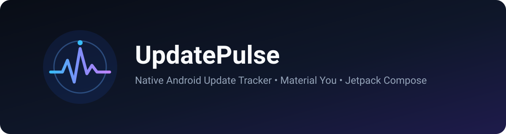
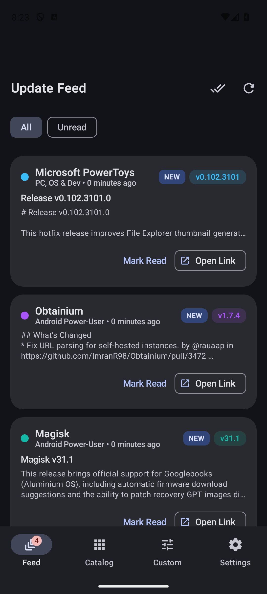
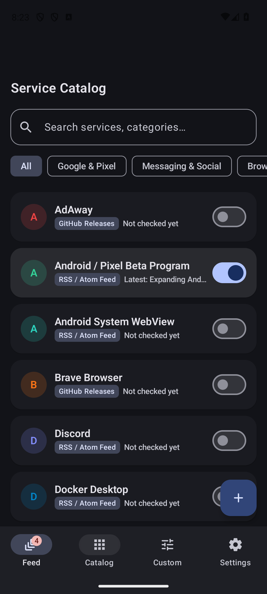
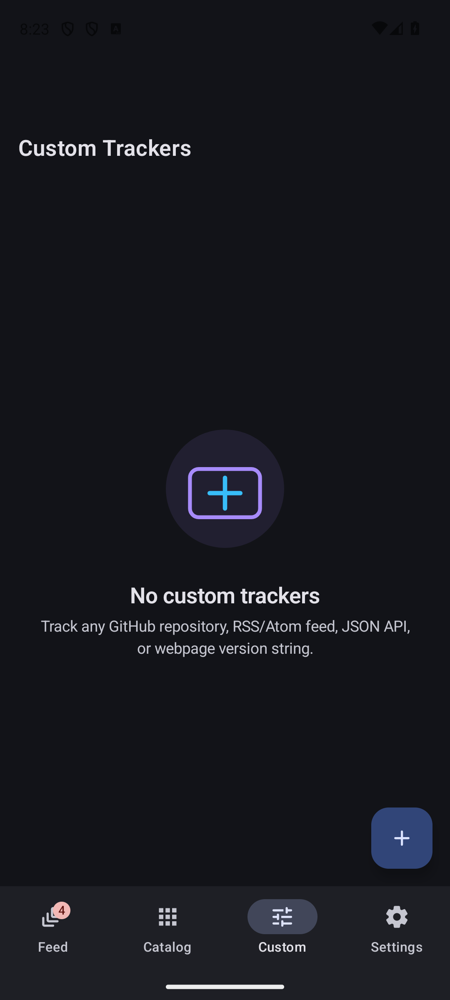
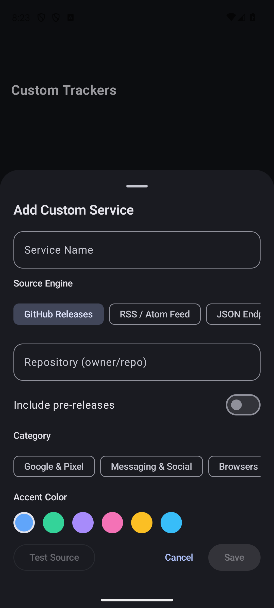

  

# UpTrack

A native Android update tracker built with **Kotlin**, **Jetpack Compose**, **Material 3 (Material You)**, **Room**, and **WorkManager**.

## Screenshots

| Update Feed | Service Catalog | Custom Trackers | Add Custom Service |
| :---: | :---: | :---: | :---: |
|  |  |  |  |

## Features

- **Curated Service Catalog:** Pre-populated, searchable catalog of 540+ services across Google & Pixel, Messaging & Social, Browsers, Android Power-User & Modding, AI & LLMs, Windows & OS, PC/Dev Tools, Smart Home & Media, Security, Self-Hosted, Gaming, and regional apps. See [SOURCES.md](SOURCES.md) for the full breakdown of update sources and engines.
- **Custom Service Trackers:** Track any **GitHub Releases** repository, **RSS/Atom** feed, **JSON** endpoint, or **Webpage** via Regex — with a built-in **Test Source** button.
- **Material You & Dark-First Design:** Dynamic Color on Android 12+, Dark Mode by default, plus AMOLED Pure Black, Light, and System themes. Full English and Hebrew (RTL) support.
- **Background Checking & Rich Notifications:** Configurable `WorkManager` polling intervals, Wi-Fi only mode, grouped notifications with **Open Link** and **Mark as Read** actions.
- **In-App Self-Updater:** Checks GitHub Releases directly from Settings, downloads the APK with live progress, and launches the Android installer via `FileProvider`.
- **Backup & Restore:** Export and import tracked subscriptions and custom services as JSON via Storage Access Framework.

## Download

Grab the latest APK from the [Releases](https://github.com/dor2500/uptrack/releases) page.
